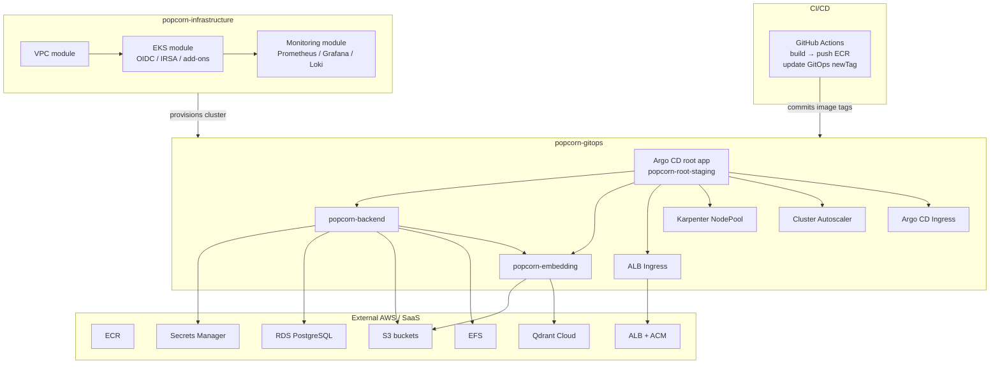
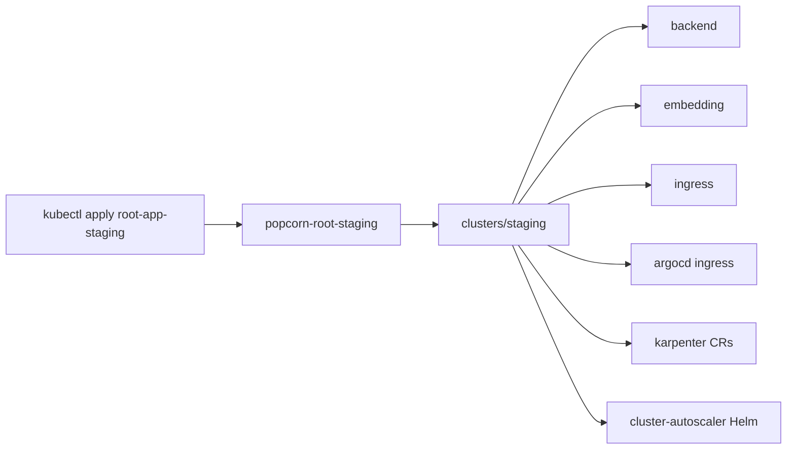

# popcorn Platform Architecture

A single reference for the full popcorn platform: AWS infrastructure (Terraform) + Kubernetes GitOps (Argo CD).

**Repos**

| Repo | Role |
|------|------|
| [popcorn-infrastructure](https://github.com/popcornVision/popcorn-infrastructure) | AWS foundation — VPC, EKS, monitoring |
| [popcorn-gitops](https://github.com/popcornVision/popcorn-gitops) | What runs *on* the cluster — apps, ingress, autoscaling CRs, secrets sync |
| App repos (e.g. `popcorn_backend`) | Application code, Docker builds, CI that updates GitOps image tags |

**Account / regions**

| | Staging | Production |
|---|---------|------------|
| AWS Account | `<redacted>` | same |
| Workload region | `us-west-1` | `us-east-1` |
| Terraform state region | `us-east-1` | `us-east-1` |
| Cluster | `popcorn-staging-eks` | `popcorn-production-eks` |
| Namespace | `popcorn-staging` | `popcorn-production` (planned) |
| Public app URL | `https://staging.popcorn.io` | TBD |
| Argo CD UI | `https://staging-argocd.popcorn.io` | TBD |
| GitOps branch | `staging` | not fully wired |

*Last consolidated: August 2026 — updated 2026-09-21. Staging is fully operational and signed off: the Sept 1–8 capacity investigation (see [§18](#18-recent-architecture-changes--load-test-findings-sept-2026)), the Sept 9–16 autoscaler-consolidation/closeout work (see [§19](#19-sept-9-16-2026-capacity-closeout--cpu-floor-fix)), and the Sept 17–21 max-pods/blue-green node migration (see [§20](#20-sept-17-21-2026-max-pods-ceiling--blue-green-node-migration)) are all closed out, with production design decisions now informed by what staging's dual-autoscaler and node-sizing history taught us.*

---

## Table of contents

1. [Big picture](#1-big-picture)
2. [Ownership split](#2-ownership-split)
3. [Infrastructure (Terraform)](#3-infrastructure-terraform)
4. [GitOps (Argo CD)](#4-gitops-argo-cd)
5. [Workloads and data plane](#5-workloads-and-data-plane)
6. [Networking and access](#6-networking-and-access)
7. [Secrets, config, and images](#7-secrets-config-and-images)
8. [Autoscaling layers](#8-autoscaling-layers)
9. [CI/CD deploy flow](#9-cicd-deploy-flow)
10. [Environments](#10-environments)
11. [Out of scope / manual pieces](#11-out-of-scope--manual-pieces)
12. [Day-2 operations](#12-day-2-operations)
13. [Key file map](#13-key-file-map)
14. [Tools inventory](#14-tools-inventory)
15. [Work & contribution themes](#15-work--contribution-themes)
16. [Interview talking points](#16-interview-talking-points)
17. [Mental model checklist](#17-mental-model-checklist)
18. [Recent architecture changes & load test findings (Sept 2026)](#18-recent-architecture-changes--load-test-findings-sept-2026)
19. [Sept 9–16 2026: capacity closeout & CPU-floor fix](#19-sept-9-16-2026-capacity-closeout--cpu-floor-fix)
20. [Sept 17–21 2026: max-pods ceiling & blue-green node migration](#20-sept-17-21-2026-max-pods-ceiling--blue-green-node-migration)

---

## 1. Big picture



**One-sentence summary**

> Terraform builds a GPU-capable EKS cluster on AWS; Argo CD App-of-Apps + Kustomize deploys and keeps apps/platform CRs in sync; CI only updates image tags in Git — Argo CD is the deployer.

---

## 2. Ownership split

| Concern | Owned by | Notes |
|---------|----------|-------|
| VPC, subnets, NAT, IGW | Terraform (`modules/vpc`) | Independent state per env |
| EKS control plane, OIDC, IRSA, add-ons | Terraform (`modules/eks`) | Includes Cluster Autoscaler IAM role |
| Prometheus / Grafana / Loki | Terraform (`modules/monitoring`) | Helm via Terraform providers |
| Bastion | Terraform module exists | **Not deployed** — OpenVPN used. ⚠ Staging `aws_region = "us-east-1"` vs VPC/EKS `us-west-1` — verify before deploying |
| Argo CD install | Manual | Then bootstrap from GitOps |
| App Deployments / Services | GitOps Kustomize | Base + overlays |
| ALB Ingress + ACM ARN refs | GitOps | ALB Controller installed manually |
| Karpenter NodePool / EC2NodeClass | GitOps | Controller IAM via `karpenter-cf.yaml` |
| Cluster Autoscaler deploy | GitOps (Helm Application) | IRSA role from Terraform |
| ExternalSecret CRs | GitOps | Operator + ClusterSecretStore assumed installed |
| RDS, Qdrant, ECR pushes, Squarespace DNS | Outside both repos | See [§11](#11-out-of-scope--manual-pieces) |

---

## 3. Infrastructure (Terraform)

### 3.1 Layout

```
popcorn-infrastructure/
├── modules/
│   ├── vpc/           # Networking
│   ├── bastion/       # Optional SSH jump (unused)
│   ├── eks/           # Cluster, IAM, OIDC, add-ons, CA IRSA
│   └── monitoring/    # Helm observability stack
├── environments/
│   ├── staging/       # us-west-1 — vpc / eks / monitoring (+ bastion stub)
│   └── production/    # us-east-1 — vpc / eks / monitoring (+ bastion stub)
├── docs/ARCHITECTURE.md
├── Makefile           # make check = fmt + validate + test + lint
└── .tflint.hcl
```

**Pattern:** reusable modules + environment roots. Each stack (`vpc`, `eks`, `monitoring`) is its **own Terraform root** with its own S3 state. No Terragrunt. No Packer.

**Deploy order:** VPC → EKS → Monitoring (bastion skipped).

### 3.2 VPC

```
<redacted>.0.0/16                    (actual CIDR redacted — structure below is accurate)
├── <redacted>.10.0/24  public  AZ-a  → NAT, ALBs
├── <redacted>.11.0/24  public  AZ-b  → NAT
├── <redacted>.20.0/24  private AZ-a  → EKS nodes
└── <redacted>.21.0/24  private AZ-b  → EKS nodes / API
```

Creates: VPC, IGW, 2 public + 2 private subnets, 2 NAT Gateways + EIPs, route tables, SSH security group. Worker nodes and control-plane ENIs live in **private** subnets; NATs provide outbound internet.

### 3.3 EKS

| Setting | Value |
|---------|-------|
| Auth mode | `API_AND_CONFIG_MAP` |
| Endpoint | Private required; public optional + IP allowlist |
| Secrets | KMS encryption at rest |
| Logging | API, audit, authenticator → CloudWatch (~30 days) |
| OIDC | Created for IRSA |
| Add-ons | `vpc-cni`, `coredns`, `kube-proxy`, `aws-ebs-csi-driver` |
| Default GPU instance | `g4dn.xlarge` |
| K8s version | `1.35` (as configured) |

**IAM / IRSA highlights**

- Cluster + node roles with standard EKS policies (+ SSM on nodes)
- EBS CSI IRSA → `AmazonEBSCSIDriverPolicy`
- Cluster Autoscaler IRSA → role `popcorn-{env}-cluster-autoscaler` (scoped to tagged ASGs)
- ALB Controller **policy** created from JSON; controller Helm install is manual
- Access entries: admins → `AmazonEKSClusterAdminPolicy`; developers → `AmazonEKSViewPolicy`

**Staging compute note (important)**

In `environments/staging/eks/terraform.tfvars`:

```hcl
create_main_node_group = false
```

So the Terraform-managed main GPU node group is **off** in staging. Capacity is expected from separately managed node groups and/or **Karpenter** (GitOps). The EKS module still owns the control plane, OIDC, add-ons, and IRSA roles.

Production EKS still expects the main node group enabled (desired ~1, max ~3) unless changed.

### 3.4 Monitoring

Helm releases into `monitoring` namespace:

| Component | Chart (pinned in docs) | Notes |
|-----------|------------------------|-------|
| Prometheus + Grafana | `kube-prometheus-stack` v55.0.0 | Grafana often LoadBalancer; EBS gp3; **Thanos sidecar** ships long-term blocks to S3 |
| Loki + Promtail | `loki-stack` v2.10.1 | Log aggregation; **S3-backed** object store, not just local EBS |

Storage: EBS CSI (local, 7-day retention on both Prometheus and Loki), Retain reclaim policy, plus two Terraform-managed S3 buckets as the durable backend:

| Bucket | Used by | Lifecycle |
|--------|---------|-----------|
| `popcorn-staging-loki-logs-<account_id>` | Loki object store | expires after `loki_s3_lifecycle_days` (default 14d) as a compactor backstop |
| `popcorn-staging-thanos-blocks-<account_id>` | Prometheus Thanos sidecar | expires after `thanos_s3_lifecycle_days` (default 30d) |

Each has its own IRSA role (`popcorn-staging-loki-s3` → `monitoring:loki`, `popcorn-staging-prometheus-s3` → `monitoring:prometheus`). **Operationally relevant:** this is why Grafana/Loki could still serve pod logs from replicas that Cluster Autoscaler had already scaled down and deleted during load testing — logs survive the pod, just not past the retention window. Grafana password passed at `terraform apply` time.

**GPU-node taint blind spot (fixed 2026-08-25):** `dcgm-exporter` and `loki-promtail` are both DaemonSets, but neither carried a toleration for `popcorn-gpu-ng`'s `nvidia.com/gpu=present:NoSchedule` taint — the same taint `popcorn-embedding` tolerates explicitly. Concretely: `dcgm-exporter` had zero running pods (so the GPU Metrics Grafana dashboard, added a week earlier, had been showing no data since it was created), and `promtail` never ran on the GPU node at all, so any logs from whatever ran there never reached Loki. Fixed by adding matching `dcgm_tolerations`/`promtail_tolerations` to `environments/staging/monitoring/main.tf`, verified live (DCGM metrics now scraping, GPU-node log lines now in Loki). Confirmed live: Prometheus's local retention is `storage.tsdb.retention.time: 1w` (direct queries against the Prometheus API only see the last ~7 days), and the `thanos-sidecar` container is genuinely running and shipping real blocks to the `popcorn-staging-thanos-blocks-<account-id>` bucket — so long-term data does exist in S3, it's just not reachable through a direct Prometheus query without a separate Thanos Querier/Store Gateway, which isn't confirmed deployed.

### 3.5 Terraform state

```
bucket  = popcorn-terraform-state-bucket
region  = us-east-1
encrypt = true
# Current backends use S3 native lockfiles (use_lockfile).
# Older docs/QUICK_REFERENCE may still mention DynamoDB locks.
```

Example keys:

```
environments/staging/vpc/terraform.tfstate
environments/staging/eks/terraform.tfstate
environments/staging/monitoring/terraform.tfstate
environments/production/...
```

**Cross-stack wiring**

- EKS reads VPC via `terraform_remote_state`
- Monitoring discovers the live cluster via `data.aws_eks_cluster` (and `aws eks get-token`)

### 3.6 Quality gates

```bash
make check   # fmt + validate + terraform test + tflint
```

Module tests live under `modules/*/tests/*.tftest.hcl`. Root README mentions GitHub Actions Terraform CI; confirm `.github/workflows` exists in the current tree before claiming it in interviews.

---

## 4. GitOps (Argo CD)

### 4.1 Layout

```
popcorn-gitops/
├── bootstrap/
│   └── root-app-staging.yaml      # Apply once after Argo CD install
├── clusters/
│   └── staging/
│       ├── kustomization.yaml     # Namespace + AppProject + apps
│       ├── namespaces/
│       ├── appprojects.yaml
│       └── apps/apps.yaml         # Child Applications
├── apps/
│   ├── popcorn-backend/             # base + overlays/staging|production
│   ├── popcorn-embedding/
│   ├── popcorn-ingress/
│   ├── argocd/
│   └── karpenter/
├── cd-deploy.yaml                 # Reference CI workflow (app repo)
├── karpenter-cf.yaml              # Karpenter IAM CloudFormation
├── iam-policy.json                # ALB Controller IAM policy helper
├── add-repo.sh
├── README.md
├── QUICK_REFERENCE.md
└── docs/PLATFORM_ARCHITECTURE.md  # This file
```

### 4.2 App-of-Apps flow

1. Install Argo CD on the cluster (manual / out of band).
2. Register the GitHub repo (see `add-repo.sh` if needed).
3. Apply bootstrap:

```bash
kubectl apply -f bootstrap/root-app-staging.yaml
```

4. Root Application `popcorn-root-staging` syncs path `clusters/staging` on branch **`staging`**.
5. That creates:
   - Namespace `popcorn-staging`
   - AppProject `staging` (allowed repos, namespaces, resource kinds)
   - Child Applications (automated sync + prune + selfHeal)



### 4.3 Child Applications

| Argo App | Source | Destination |
|----------|--------|-------------|
| `popcorn-backend-stg` | `apps/popcorn-backend/overlays/staging` | `popcorn-staging` |
| `popcorn-embedding-stg` | `apps/popcorn-embedding/overlays/staging` | `popcorn-staging` |
| `popcorn-ingress-stg` | `apps/popcorn-ingress/overlays/staging` | `popcorn-staging` |
| `argocd-ingress-stg` | `apps/argocd/overlays/staging` | `argocd` |
| `karpenter-stg` | `apps/karpenter/overlays/staging` | `karpenter` |
| `cluster-autoscaler-stg` | Helm chart `cluster-autoscaler` 9.57.0 | `kube-system` |
| `descheduler-stg` | Helm chart `descheduler` 0.35.1 (upstream `kubernetes-sigs.github.io/descheduler`) | `descheduler` |

Sync policy everywhere: **automated + prune + selfHeal**.

### 4.4 Kustomize pattern

- **Base:** env-agnostic Deployment / Service / ConfigMap (placeholder `:latest` image).
- **Overlay:** namespace, real config literals, ExternalSecrets, HPA, EFS, nodeSelector/tolerations, rollout strategy, **pinned `newTag`**.

Example (staging backend image pin):

```yaml
images:
  - name: <account-id>.dkr.ecr.us-west-1.amazonaws.com/popcorn-shazam-backend
    newTag: "e109761"   # short git SHA from CI
```

### 4.5 AppProject allowlist

The `staging` project restricts:

- Source repos: this GitOps GitHub repo + Kubernetes autoscaler Helm repo + Descheduler Helm repo (`kubernetes-sigs.github.io/descheduler`, added 2026-09-15)
- Destinations: `popcorn-staging`, `argocd`, `karpenter`, `kube-system`, `descheduler` (added 2026-09-15)
- Namespaced kinds: ConfigMap, Secret, Service, PVC, Deployment, Ingress, ExternalSecret, HPA, `batch/CronJob` (added 2026-09-15 for the Descheduler), etc.
- Cluster kinds: Karpenter `NodePool` / `EC2NodeClass`, StorageClass, ClusterRole(Binding)

This is a deliberate blast-radius / least-privilege pattern for Argo CD projects — the tradeoff is that adding any new tool (new repo, new namespace, new resource kind) needs an explicit `AppProject` update first, or the new `Application` sits at `Unknown` sync status with an `InvalidSpecError` until it's added. This exact sequence happened live when the Descheduler was first added; see [§19](#19-sept-9-16-2026-capacity-closeout--cpu-floor-fix).

---

## 5. Workloads and data plane

### 5.1 popcorn-backend

| Item | Detail |
|------|--------|
| Role | HTTP API for the product |
| Container port | `3000` (Service `:80`) |
| Health | `/health` readiness + liveness |
| Resources (overlay) | requests **700m CPU** / 2Gi, limits 2 CPU / 6Gi — lowered from 1000m on 2026-09-15 after real usage data (peak observed: 358m) showed the original request was ~3x actual need and didn't fit two replicas per floor node; see [§19](#19-sept-9-16-2026-capacity-closeout--cpu-floor-fix) |
| Staging replicas | HPA **`minReplicas: 2`** (raised from 1 on 2026-09-15 for real HA and to unblock the PDB/Descheduler interaction), **maxReplicas 20** @ 75% CPU/mem |
| Placement | **CPU-only** — runs on `popcorn-cpu-ng-v2` (or Karpenter `staging-general`), preferred via a `node-type: cpu` label affinity (see [§20](#20-sept-17-21-2026-max-pods-ceiling--blue-green-node-migration)). No GPU nodeSelector, toleration, or affinity — removed 2026-09-01 (see [§18](#18-recent-architecture-changes--load-test-findings-sept-2026)); backend never used the GPU, it was only pinned there by a required podAffinity to embedding |
| Scheduling resilience | `topologySpreadConstraints` (maxSkew 1, per-node) spreads new replicas across nodes during scale-up; `PodDisruptionBudget` (`minAvailable: 1`) stops Cluster Autoscaler from evicting the last replica during consolidation |
| Storage | EFS RWX PVC `backend-uploads-efs` (10Gi request) on filesystem `fs-<redacted>`, dynamic access-point provisioning (`efs-ap`), `directoryPerms: "750"`, gid range 1000–2000, base path `/popcorn-backend-uploads`, `Retain` reclaim policy. Filesystem itself is manually provisioned — not a Terraform resource. |
| Config | RDS host, Qdrant URL (`us-west-1`, same region as the cluster), S3 buckets, embedding URL, region (ConfigMap) |
| Secrets | ExternalSecret → `backend-secrets` from SM key **`popcorn/staging/backend/credentials`** (us-west-1) — confirmed via CloudTrail as the sole live source, read hourly by `external-secrets-provider-aws`. This is also where the live `QDRANT_URL` comes from — a stale EU-region URL still sits as a ConfigMap literal but is overridden by the Secret; see [§18](#18-recent-architecture-changes--load-test-findings-sept-2026). **Do not confuse with `popcorn/backend/credentials`** — a similarly-named secret exists in *both* us-east-1 (genuinely used, by production's CI deploy script default) and us-west-1 (an orphaned leftover with zero real reads ever recorded — flagged for deletion, see [§19](#19-sept-9-16-2026-capacity-closeout--cpu-floor-fix)) |
| AWS access | **No IRSA role found in either repo for the backend pod's service account**, despite it calling S3, SQS, and Secrets Manager — worth confirming with whoever set this up whether it's using the node instance role (broader-than-necessary access) or an IRSA binding that exists only in AWS console, not in code |
| Metrics | `PROMETHEUS_METRICS_ENABLED=true` in staging |

Calls embedding in-cluster at `http://popcorn-embedding`.

### 5.2 popcorn-embedding

| Item | Detail |
|------|--------|
| Role | GPU inference / embeddings |
| Container port | `5000` (Service `:80`) |
| GPU | requests/limits `nvidia.com/gpu: 1` |
| Memory/CPU | ~8Gi / 1–2 CPU |
| Probes | Long `startupProbe` (model load), then readiness/liveness on `/health` |
| HPA | **1–5** @ 75% CPU/mem (raised from 1–3; CPU utilization has stayed under ~40% at every load level tested through 8,000 users) |
| Placement | Sole occupant of `popcorn-gpu-ng` since backend was separated onto CPU nodes 2026-09-01 |
| Config | S3 model bucket + checkpoint path |
| Secrets | ExternalSecret → `embedding-secrets`, but **sourced from the same SM key as backend** (`popcorn/staging/backend/credentials`) — there's no separate embedding-specific secret path, worth a look if that's meant to be scoped tighter |

### 5.3 Ingress routing

`staging.popcorn.io` (ALB, internet-facing, IP targets, HTTP→HTTPS, ACM cert):

| Path | Backend |
|------|---------|
| `/` | `popcorn-backend:80` |
| `/embed` | `popcorn-embedding:80` |

Separate ALB group for Argo CD UI: `staging-argocd.popcorn.io`.

### 5.4 External data services

| Service | Usage |
|---------|--------|
| RDS PostgreSQL | App DB (`art_db` staging host in ConfigMap) |
| Qdrant Cloud | Vector search — `us-west-1` cluster (same region as EKS; a stale EU-region URL in the ConfigMap is dead config, see [§18](#18-recent-architecture-changes--load-test-findings-sept-2026)) |
| S3 | Images, thumbnails, profile pictures, query images, model checkpoints |
| EFS | Multi-AZ shared uploads for backend |
| ECR | `popcorn-shazam-backend`, `popcorn-shazam-embedding` |

---

## 6. Networking and access

### Access model

| Method | Status |
|--------|--------|
| OpenVPN | **Primary** for kubectl / private access |
| Bastion | Module exists; **not deployed** |
| EKS public API | Optional; **CIDR allowlisted** in tfvars |
| Public app traffic | ALB → pods (IP mode) |

### Refresh kubeconfig

```bash
aws eks update-kubeconfig --region us-west-1 --name popcorn-staging-eks
```

EKS tokens expire ~15 minutes; re-run when kubectl fails auth.

### DNS / TLS

- DNS: **Squarespace** (not Route53 in this setup)
- TLS: **ACM** certificates; ARNs referenced in Ingress annotations

---

## 7. Secrets, config, and images

| Kind | Mechanism | Example |
|------|-----------|---------|
| Non-secret config | Kustomize `configMapGenerator` merge | `DB_HOST`, `QDRANT_URL`, bucket names |
| Secrets | External Secrets Operator → AWS Secrets Manager | `popcorn/staging/backend/credentials` |
| Images | ECR + Kustomize `images.newTag` | Short git SHA, same tag for backend+embedding when built together |

**Rule:** never commit plaintext credentials. Git holds secret *references* and non-secret config only.

Assumed cluster install (not in Terraform modules): External Secrets Operator + `ClusterSecretStore` named `aws-secretsmanager`.

---

## 8. Autoscaling layers

Four distinct layers — do not conflate them in interviews:

| Layer | Tool | Scales what |
|-------|------|-------------|
| Pods | HPA (CPU/memory 75%) | Backend **2–20**, Embedding **1–5** (embedding's HPA lost its `memory` metric entirely on 2026-09-10 — see below) |
| Managed node groups | Cluster Autoscaler (Helm + IRSA) | EKS ASGs tagged for this cluster |
| On-demand general CPU | Karpenter NodePool `staging-general` | `m6i` large/xlarge; consolidate when empty/underutilized; CPU limit (e.g. 20) |
| Pod placement correction | **Descheduler** (Helm chart, CronJob, every 15 min) | Evicts pods that violate a *preferred* node affinity, via the standard Eviction API (so it respects PDBs) — added 2026-09-15 specifically to correct backend pods that Karpenter's NodePool wins the placement race for, see below |

**Embedding's HPA memory-metric bug (fixed 2026-09-10):** embedding's HPA originally scaled on both CPU *and* memory at 75%. A real CPU spike pushed it 1→2 replicas; a second GPU node (`popcorn-gpu-ng`) was correctly auto-provisioned to fit it. But the model's memory footprint sits at a near-fixed ~54% regardless of replica count, so the HPA's scale-down math could never converge back below 2 replicas once triggered — the 2nd GPU node became permanent, not because of real ongoing demand, but because of a metric that couldn't signal "scale down." Fix: removed `memory` from embedding's HPA entirely; CPU alone now drives it. Confirmed live: scaled itself back to 1 replica within seconds of the fix landing.

**Karpenter-vs-Cluster-Autoscaler race (investigated and fixed 2026-09-15/16):** `popcorn-cpu-ng` and Karpenter's `staging-general` NodePool are two *independent* autoscalers that both react to the same pending-pod signal — `staging-general` was added later, deliberately, via `OPS-232` ("Karpenter installation for HPA provisioning") specifically for faster burst reaction than Cluster Autoscaler provides, then narrowed to `m6i.large`/`m6i.xlarge` only via `OPS-238`. In practice, Karpenter frequently won the race to schedule a backend pod even when the `popcorn-cpu-ng` floor had genuine spare room — because kube-scheduler hadn't finished evaluating existing nodes before Karpenter's provisioning loop acted. The result: a 3rd (sometimes more) CPU node running semi-permanently, holding just one backend pod, with no mechanism to consolidate it back — Karpenter only rebalances pods across nodes *it* manages, and Cluster Autoscaler has no visibility into Karpenter's decisions or vice versa.

**Fix, two parts:**
1. **Soft node affinity** (`preferredDuringSchedulingIgnoredDuringExecution`, weight 100) on the backend Deployment, originally toward `eks.amazonaws.com/nodegroup: popcorn-cpu-ng` — a preference, not a hard requirement, so Karpenter bursting under genuine overflow still works. Alone, this was *not* sufficient — it doesn't slow Karpenter down, so it still lost the race during rollouts. **Generalized 2026-09-17** to match the `node-type: cpu` label instead of the specific nodegroup name, so it survives a nodegroup rename/replacement (see [§20](#20-sept-17-21-2026-max-pods-ceiling--blue-green-node-migration)) without the Descheduler perpetually evicting pods against a now-nonexistent nodegroup reference.
2. **Descheduler**, running the single `RemovePodsViolatingNodeAffinity` plugin against that same preference, capped at 1 eviction/node/namespace per run. It doesn't try to win the scheduling race; it detects and corrects the outcome afterward, via the standard (PDB-respecting) Eviction API. Deployed cautiously — dry-run first, verified detecting the exact stranded pod and nothing else, then flipped live only once the backend's resource request was confirmed to actually fit two replicas per floor node (see the CPU-request note in [§5.1](#51-popcorn-backend)).

A hard `requiredDuringSchedulingIgnoredDuringExecution` affinity was considered and explicitly rejected: `popcorn-cpu-ng`'s max-6-node ceiling covers only ~9–10 backend replicas at current request sizing, well short of the ~18 replicas the load test showed were needed at 6,000 concurrent users — hard-pinning would silently reintroduce the exact HPA-ceiling capacity bug already fixed once (§18.1, 09-02/03 row).

Full investigation, including a genuine incident where a mis-calculated capacity margin caused real eviction/reschedule thrashing before the actual fix (the CPU *request*, not the scheduling mechanism, was oversized) is in [§19](#19-sept-9-16-2026-capacity-closeout--cpu-floor-fix).

**Production design implication:** rather than replicate this same two-autoscaler pattern in production and patch around it reactively, the production Terraform/GitOps design should go Karpenter-only for workload capacity from day one (small dedicated system-tier for platform pods only, Karpenter NodePools — CPU and GPU — for everything else), eliminating this class of race at the architecture level. See [§19](#19-sept-9-16-2026-capacity-closeout--cpu-floor-fix) and the production ticket backlog.

**Live EKS node group floors (as of 2026-09-16 — unchanged since 09-08; what changed was making sure workload actually *stays* on these floors, see below):**

| ASG | Min | Desired | Max | Instance type | Hosts |
|-----|-----|---------|-----|---------------|-------|
| `popcorn-cpu-ng-v2` | **2** | 2 | 6 | `m6i.xlarge` | `popcorn-backend` + platform pods (ArgoCD, Karpenter, DaemonSets) — replaced `popcorn-cpu-ng` (`m6i.large`) 2026-09-19/20 via blue-green migration, see [§20](#20-sept-17-21-2026-max-pods-ceiling--blue-green-node-migration) |
| `popcorn-gpu-ng` | **1** | 1 | 6 | `g4dn.xlarge` | `popcorn-embedding` only |
| `popcorn-cpu-az1-ng` | 0 | 0 | 1 | `m6i.large`, `us-west-1a` only | retired 2026-08-24 once monitoring moved off single-AZ EBS to S3; kept at 0 as a one-line revert, not deleted |

All three are genuine Terraform resources (`environments/staging/eks/terraform.tfvars`, imported from what were originally ad-hoc AWS-CLI-managed groups) — this is the one part of staging compute that *is* fully IaC-owned. Karpenter's `staging-general` NodePool, by contrast, is pure Kubernetes manifest + a separate CloudFormation template (`karpenter-cf.yaml`) for its controller IAM and node role — not Terraform at all.

The CPU floor of 2 is deliberate, not incidental — it exists so Cluster Autoscaler always has a second node to consolidate onto without ever fully draining the tier (see the outage entry in [§18](#18-recent-architecture-changes--load-test-findings-sept-2026)). A 4th node commonly appears alongside these three floors: Karpenter's `staging-general` NodePool provisions its own on-demand node whenever the backend pod needs to schedule and the ASG-floor nodes don't have room — that node's lifecycle is tied to the workload it's carrying, not a fixed floor, and Karpenter reclaims it once nothing needs it.

**Karpenter CRDs** (GitOps):

- `EC2NodeClass` `staging-general` — role `KarpenterNodeRole-popcorn-staging-eks`, subnet/SG discovery tag `karpenter.sh/discovery: popcorn-staging-eks`, AL2023 AMI, gp3 root volume
- `NodePool` — amd64/linux, m6i family, consolidation `WhenEmptyOrUnderutilized`

**Karpenter IAM:** CloudFormation template `karpenter-cf.yaml` in this repo (not the Terraform EKS module).

**Cost control idea:** weekend scale-down of node groups + set Karpenter NodePool CPU limit to `0`; stop RDS. See README / ops cheatsheets.

---

## 9. CI/CD deploy flow

```
developer pushes to develop (app repo)
        │
        ▼
GitHub Actions (often self-hosted runner)
  1. aws-actions/configure-aws-credentials
  2. build-and-push.sh → ECR (backend + embedding)
        │
        ▼
update-gitops job
  1. checkout popcornVision/popcorn-gitops (token)
  2. sed newTag in both staging kustomizations to GITHUB_SHA::7
  3. commit + push  "deploy(staging): backend+embedding <sha>"
        │
        ▼
Argo CD detects Git change → sync → rolling update
```

Reference workflow file in this repo: `cd-deploy.yaml` (intended home: app repo `.github/workflows/`).

**Manual equivalent** (from `QUICK_REFERENCE.md`): build/push locally, set `IMAGE_TAG` from `git rev-parse --short HEAD`, sed both overlays, commit, push.

**Deploy contract:** CI never `kubectl apply`s apps. Git is the source of truth; Argo CD is the deployer.

---

## 10. Environments

| Aspect | Staging | Production |
|--------|---------|------------|
| Infra env path | `environments/staging/*` | `environments/production/*` |
| Region | `us-west-1` | `us-east-1` |
| GitOps cluster entry | `clusters/staging/` **exists** | `clusters/production/` **missing** |
| Backend overlay | Full (HPA, secrets, EFS, image pin, patches) | Partial scaffolding |
| Embedding overlay | Full | Minimal |
| Ingress / Karpenter / CA apps | Present | Not present in GitOps yet |
| Live Git revision | Branch `staging` | Not bootstrapped the same way |

Production Terraform apply for EKS may require two var files (`../terraform.tfvars` + local `terraform.tfvars`) for IAM/CIDRs vs sizing.

---

## 11. Out of scope / manual pieces

These are required for the platform but **not** fully owned by the Terraform modules:

| Piece | Typical ownership |
|-------|-------------------|
| RDS PostgreSQL | Pre-existing / manual — no `aws_db_instance` in Terraform; instance identifier/class only knowable by inspecting the live AWS account |
| S3 app buckets (images, thumbnails, profile pictures, query images, model checkpoints) | Pre-existing / manual — referenced by name in GitOps ConfigMaps only, no `aws_s3_bucket` resource for any of them (contrast with the monitoring stack's Loki/Thanos buckets, which *are* Terraform-managed) |
| SQS upload queue (`S3_UPLOAD_QUEUE_URL`, `us-east-1`) | Pre-existing / manual — not declared anywhere in either repo; the only SQS resource in code is Karpenter's unrelated spot-interruption queue |
| Qdrant Cloud | SaaS |
| Argo CD install | Manual kubectl/Helm, then GitOps bootstrap |
| AWS Load Balancer Controller | Manual Helm (+ IAM policy from infra/gitops JSON) |
| NVIDIA device plugin | Manual |
| External Secrets Operator + ClusterSecretStore | Manual / platform bootstrap |
| EFS filesystem + CSI | Manual FS; StorageClass/PVC in GitOps |
| Karpenter controller + IAM CF | CF in gitops + Helm/install outside NodePool CRs |
| ACM certificates | Manual; ARNs in Ingress |
| DNS | Squarespace |
| ECR image builds | App CI |

Knowing this boundary is important: infra stays focused; GitOps and runbooks cover the rest.

---

## 12. Day-2 operations

### Health checks

```bash
kubectl get nodes -o custom-columns='NAME:.metadata.name,TYPE:.metadata.labels.node-type,INSTANCE:.metadata.labels.node\.kubernetes\.io/instance-type'
kubectl get pods -n popcorn-staging -o wide
kubectl get hpa -n popcorn-staging
kubectl get applications -n argocd
curl -s https://staging.popcorn.io/health
```

### Rollouts / logs

```bash
kubectl rollout status deployment/popcorn-backend -n popcorn-staging
kubectl logs -f deployment/popcorn-backend -n popcorn-staging
kubectl logs -f deployment/popcorn-embedding -n popcorn-staging
kubectl describe pod -l app=popcorn-backend -n popcorn-staging
```

### Common failures

| Symptom | Likely cause |
|---------|--------------|
| Pod Pending (GPU) | No GPU node / device plugin / taint mismatch |
| ImagePullBackOff | Tag missing in ECR / wrong region |
| kubectl unauthorized | Refresh kubeconfig; check EKS access entries |
| Argo not syncing | App health in UI; repo credentials; wrong branch |
| Terraform state lock | Clear stale lock (S3 lockfile or legacy DynamoDB per docs) |

### Steady-state cost posture (staging docs)

**Superseded 2026-09-01, floor instance type superseded 2026-09-19/20.** Backend and embedding are now fully separated (see [§18](#18-recent-architecture-changes--load-test-findings-sept-2026)), so idle steady-state is **1 GPU node (`popcorn-gpu-ng` floor, `g4dn.xlarge`) + 2 CPU nodes (`popcorn-cpu-ng-v2` floor, `m6i.xlarge`)** — 3 nodes minimum, not the old "1 GPU + 1 CPU co-located" model. The 2-node CPU floor is a deliberate trade (one extra always-on node) made to prevent the Cluster Autoscaler eviction outage from recurring — see the same section for why. The floor's instance type moved from `m6i.large` to `m6i.xlarge` in the [§20](#20-sept-17-21-2026-max-pods-ceiling--blue-green-node-migration) migration, specifically to raise the per-node max-pods ceiling — it was not a CPU/memory sizing decision.

---

## 13. Key file map

### Infrastructure

| Concern | Path |
|---------|------|
| Infra architecture doc | `popcorn-infrastructure/docs/ARCHITECTURE.md` |
| Staging EKS composition | `environments/staging/eks/main.tf` |
| Staging EKS sizing / access | `environments/staging/eks/terraform.tfvars` |
| EKS module | `modules/eks/main.tf` |
| Cluster Autoscaler IRSA | `modules/eks/cluster-autoscaler.tf` |
| VPC module | `modules/vpc/main.tf` |
| Monitoring Helm | `modules/monitoring/main.tf` |
| Dev checks | `Makefile`, `.tflint.hcl` |

### GitOps

| Concern | Path |
|---------|------|
| Root bootstrap | `bootstrap/root-app-staging.yaml` |
| App-of-Apps | `clusters/staging/kustomization.yaml` |
| Child Applications | `clusters/staging/apps/apps.yaml` |
| AppProject RBAC | `clusters/staging/appprojects.yaml` |
| Backend staging overlay | `apps/popcorn-backend/overlays/staging/kustomization.yaml` |
| Backend base Deployment | `apps/popcorn-backend/base/deploy.yaml` |
| Embedding GPU Deployment | `apps/popcorn-embedding/base/deploy.yaml` |
| Public Ingress | `apps/popcorn-ingress/overlays/staging/ingress.yaml` |
| Argo CD Ingress | `apps/argocd/overlays/staging/ingress.yaml` |
| Karpenter NodePool | `apps/karpenter/overlays/staging/nodepool.yaml` |
| ExternalSecret | `apps/popcorn-backend/overlays/staging/external-secret.yaml` |
| HPA | `apps/*/overlays/staging/hpa.yaml` |
| EFS PVC / StorageClass | `apps/popcorn-backend/overlays/staging/pvc-efs.yaml`, `efs-storageclass.yaml` |
| Backend node affinity (Karpenter-race fix) | `apps/popcorn-backend/overlays/staging/node-affinity.yaml` |
| Descheduler Application (Helm) | `clusters/staging/apps/apps.yaml` (`descheduler-stg` block) |
| AppProject allow-lists | `clusters/staging/appprojects.yaml` |
| CI → GitOps contract | `cd-deploy.yaml` |
| Ops quick cmds | `QUICK_REFERENCE.md` |

---

## 14. Tools inventory

| Layer | Tools |
|-------|--------|
| IaC | Terraform ≥1.5, AWS provider ~>5, TLS provider, TFLint, Terraform native tests, Make |
| Cluster | Amazon EKS, managed node groups (optional), Karpenter, Cluster Autoscaler, Descheduler, NVIDIA GPU |
| Deploy | Argo CD (App-of-Apps), Kustomize, Helm (CA + monitoring) |
| Networking | VPC, NAT, ALB Ingress Controller, ACM, OpenVPN |
| Data / storage | RDS Postgres, Qdrant Cloud, S3, EFS, EBS CSI |
| Security | IAM, IRSA/OIDC, KMS, Secrets Manager, External Secrets, IP-restricted API, AppProjects |
| Observability | Prometheus, Grafana, Loki, Promtail |
| CI/CD | GitHub Actions, ECR, self-hosted runners (app builds) |

---

## 15. Work & contribution themes

Use this section when describing what you built or operated:

1. **Modular AWS IaC** — VPC/EKS/monitoring modules, remote state, env isolation (staging vs production regions).
2. **Secure EKS foundation** — private workers, KMS secrets, control-plane logging, OIDC/IRSA, access entries.
3. **GitOps delivery** — Argo CD App-of-Apps, Kustomize base/overlay, automated sync/self-heal, AppProject allowlists.
4. **GPU ML workload on Kubernetes** — embedding service with `nvidia.com/gpu`, taints/tolerations, node selectors, long startup probes.
5. **Multi-layer autoscaling** — HPA + Cluster Autoscaler + Karpenter, with cost controls (scale-to-zero / NodePool limits).
6. **Secrets hygiene** — Secrets Manager + External Secrets; no secrets in Git.
7. **Ingress / TLS** — ALB annotations, ACM, path-based routing for API vs embed.
8. **Shared storage** — EFS RWX for multi-AZ uploads.
9. **Observability** — Prometheus/Grafana/Loki via Terraform Helm.
10. **CI ↔ GitOps contract** — SHA-tagged ECR images; Git commit is the deploy artifact.
11. **Day-2 ops** — runbooks, weekend cost shutdown, kubeconfig refresh, ImagePull/GPU Pending debugging.

Be honest in interviews about what was **Terraform-managed vs manual/GitOps-adjacent** (ALB Controller, Argo install, NVIDIA plugin, EFS FS, Karpenter CF, ACM/DNS).

---

## 16. Interview talking points

### Elevator pitch (~30s)

> We split cloud foundation from app delivery. Terraform provisions VPC and a GPU-capable EKS cluster with OIDC/IRSA and monitoring. Argo CD App-of-Apps watches the GitOps repo on the staging branch and deploys backend, embedding, ALB ingress, Karpenter CRs, and Cluster Autoscaler. CI builds to ECR and only updates Kustomize image tags — Argo CD rolls the cluster. Secrets come from Secrets Manager via External Secrets; embedding is a GPU workload with HPA and node autoscaling underneath.

### Likely follow-ups

| Question | Answer direction |
|----------|------------------|
| Why GitOps vs kubectl? | Drift detection, audit trail, env overlays, CI never needs cluster credentials for deploys |
| Why IRSA? | Short-lived AWS creds for pods (CSI, Cluster Autoscaler) without widening node instance role |
| Why Karpenter *and* CA? | CA for managed node-group ASGs; Karpenter for flexible general CPU with consolidation |
| How do you promote? | Overlay image tags + config; prod overlays exist but cluster App-of-Apps not fully wired yet |
| How are secrets handled? | SM + ExternalSecret; Git only has references and non-secret ConfigMaps |
| Staging GPU NG off in TF? | Capacity moved toward Karpenter / separately managed NGs to avoid double-managing ASGs |
| Cost control? | Steady 1 GPU + 1 CPU; weekend scale node groups / Karpenter limits; stop RDS |

### Do not overclaim

- Terragrunt / Packer — **not used**
- Route53 — DNS is Squarespace
- Full production GitOps — overlays/scaffolding exist; staging is the complete path
- Root README vs `docs/ARCHITECTURE.md` — prefer architecture docs if they disagree (e.g. locking model)

---

## 17. Mental model checklist

If you are rereading this months later, walk this list:

1. Two repos: **infra = AWS**, **gitops = cluster desired state**.
2. Apply order: VPC → EKS → monitoring → (manual add-ons) → Argo bootstrap → apps sync.
3. Staging Git branch for Argo is **`staging`**, region **`us-west-1`**, cluster **`popcorn-staging-eks`**.
4. Deploy = change `newTag` in Git → Argo syncs.
5. Backend = API + EFS + Secrets; Embedding = GPU + model from S3.
6. Traffic: Squarespace DNS → ACM/ALB → Ingress paths `/` and `/embed`.
7. Scale: HPA (pods) → CA / Karpenter (nodes).
8. Secrets never in Git; ConfigMaps hold non-secret endpoints/buckets.
9. Production is same pattern, different region — GitOps entrypoint incomplete.
10. When stuck: refresh kubeconfig, check Argo apps, ECR tags, GPU nodes, ExternalSecret status.

---

## 18. Recent architecture changes & load test findings (Sept 2026)

Staging went through a structured capacity investigation from **2026-09-01 to 2026-09-08**, prompted by a staging load test that couldn't push past ~2,000–6,000 concurrent users. Each blocker was root-caused and fixed in sequence; this section is the durable record once the day-to-day investigation notes have scrolled out of chat history. Full step-by-step data lives in `load-test-reports/staging-load-test-2026-08-26.md` (separate repo).

### 18.1 Fixes shipped

| Date | Issue | Root cause | Fix |
|------|-------|------------|-----|
| 09-01 | Backend permanently capped at 1 GPU node even after the GPU vCPU quota was raised | Backend had a **required** podAffinity to `popcorn-embedding` (co-locate on the same node) plus a GPU `nodeSelector`/toleration — despite never actually requesting `nvidia.com/gpu` itself. A fresh GPU node never has an embedding pod on it yet, so Cluster Autoscaler could never schedule backend onto a new one. | Removed the nodeSelector, toleration, and required affinity from the backend overlay. Backend now schedules on ordinary CPU capacity, fully decoupled from GPU node count/quota. |
| 09-01 | New replicas failing to stabilize during scale-up (`connection refused` on startup probe, repeated restarts) | No topology spread — the scheduler stacked multiple new pods onto one already-hot node while a freshly launched idle node sat unused, starving new pods of CPU at boot. | Added `topologySpreadConstraints` (maxSkew 1, per-hostname) to the backend Deployment. |
| 09-01 | Full backend outage (HTTP 503) | Once backend moved onto regular, drainable CPU nodes, Cluster Autoscaler began evicting the sole backend replica (`minReplicas: 1` at idle) for node consolidation the instant it finished starting — an infinite loop with no PDB to stop it. | Added a `PodDisruptionBudget` (`popcorn-backend-pdb`, `minAvailable: 1`). Cluster Autoscaler must respect PDBs, so it can no longer evict the last replica. Resolved within ~1 minute of applying. |
| 09-02/03 | HPA ceiling reached before real demand | Live HPA math at 6,000 users showed the deployment wanted ~18 replicas but was capped at `maxReplicas: 10`. | Raised backend `maxReplicas` 10→20 and embedding 3→5. |
| 09-02/03 | New backend pods took a consistent **~8 minutes** to become Ready under load, even on fully idle nodes | `docker-entrypoint.sh` ran `chmod -R 777 /app/tmp` on every container boot — `/app/tmp` is the EFS-mounted upload volume, which had accumulated 69,434 files from real usage and repeated load testing. Timing the exact command against the live volume measured 7m46s, matching the observed delays almost exactly. | Changed `chmod -R 777 /app/tmp` → `chmod 777 /app/tmp` (dropped the recursive flag) in the app repo's entrypoint script. Deployed as image `850fa7e`. Verified live: container-start → first app log line dropped from ~8 minutes to **0.76 seconds**. |

### 18.2 Resolved — see §19 for confirmation

> **Status update (2026-09-16): fixed and re-tested.** The connection-pooling fix described below shipped on the app side and Dev has since re-run load testing against it, confirmed stable. The ramp past 8,000 users, and the full capacity closeout, is in [§19](#19-sept-9-16-2026-capacity-closeout--cpu-floor-fix). The investigation notes below are kept as-written for the historical root-cause record.

**Vector search (Qdrant) latency climbing under load at 8,000 concurrent users.** During the 8,000-user step, Qdrant search latency climbed from ~20s to ~28s within a single ~3-minute window at steady load — a monotonic upward trend, unlike every prior failure pattern seen at lower steps (which were flat from request #1, i.e. test-data artifacts, not real degradation). Consequences: 10 client read-timeouts, 1 connection error, and `/api/identify` median response time rising to 3.1s (avg 5.9s) from ~2.2s at 7,000 users.

Ruled out: RDS (48% CPU, not saturated), the embedding service (GPU node at 16% CPU, effectively idle), backend pods (clean scale-up, zero restarts/evictions), the ALB/network layer (only one target-level 5xx across the whole window, zero connection errors, target group stayed healthy throughout), and — after an initial false lead — a Qdrant region mismatch (a stale EU-region URL sits as a dead ConfigMap literal, but the live pod environment and AWS Secrets Manager both confirmed the actual, correct Qdrant Cloud cluster is `us-west-1`, the same region as the EKS cluster).

**Root cause identified:** the Qdrant client (`src/config/qdrant.js`) has no custom HTTP connection-pool sizing, relying on Node's small default `fetch` pool for all outbound calls. Every single `/api/identify` request fires **two concurrent Qdrant searches** (style + content vectors), so real concurrent demand on that shared pool is roughly double the raw request rate. Under load, calls queue for a free socket, and `maxRetries: 3` compounds the problem by retrying against an already-congested pool — a feedback loop that plausibly explains the climb from 20s to 28s at a steady load level.

**Fix (scoped, not yet shipped):** give the process a properly sized connection pool (e.g. `undici`'s `setGlobalDispatcher` with a much higher `connections` limit) at the app entrypoint, and reduce `maxRetries` from 3 to 1. This is a backend code change through the normal CI/CD → image tag → GitOps flow, not an infra-side mitigation. **The load-test ramp is paused at 8,000 users pending this fix.**

### 18.3 Other open items surfaced along the way

- A stale `QDRANT_URL` (wrong region) still sits as a plaintext literal in `apps/popcorn-backend/overlays/staging/kustomization.yaml`'s `configMapGenerator`. It's harmless today only because `envFrom` loads the Secret *after* the ConfigMap in `base/deploy.yaml`, so the Secret's correct value wins — but if the ExternalSecret ever fails to sync, the app would silently fall back to the wrong region with no error. Should be deleted.
- `/app/tmp/pending-uploads` and `/app/tmp/uploads/thumbnails` on the EFS volume have 69,000+ accumulated files with no apparent cleanup/TTL step — worth fixing independent of the chmod fix above, since the volume will keep growing.
- One `loki-promtail` DaemonSet pod has been stuck `Pending` for 47+ hours on one node — a monitoring blind spot (that node's logs aren't reaching Loki/Grafana) that hasn't blocked anything yet but should be closed before the next large run.
- Two non-blocking, cosmetic issues logged on every backend boot: a missing CloudWatch log group, and a Qdrant client/server version mismatch warning (client 1.14.1 vs server 1.18.3).

### 18.4 Validated capacity (staging, this cycle)

500 → 3,500 → 4,000 → 5,000 → 6,000 → 7,000 → **8,000** concurrent users all pass cleanly on infrastructure grounds (zero restarts, zero evictions, clean HPA/ArgoCD behavior, RDS well within margin) with the fixes above in place. 9,000–10,000 are the next steps once the Qdrant connection-pooling fix ships. A shareable summary of this whole investigation (architecture + timeline + capacity chart) is maintained separately as a rendered artifact for non-engineering stakeholders.

---

## 19. Sept 9–16 2026: capacity closeout & CPU-floor fix

Follow-on to [§18](#18-recent-architecture-changes--load-test-findings-sept-2026): the Qdrant fix shipped, capacity work closed out, and a separate, previously-undocumented autoscaler bug (the CPU-floor/Karpenter race) was found and fixed.

### 19.1 Capacity closeout — staging fully operational

- **Qdrant connection-pooling fix**: shipped on the app side, re-tested by Dev, confirmed stable under load. The 20s→28s climb described in §18.2 no longer occurs.
- **Second load-testing effort**: an independently-authored "realistic-load-model" harness (GPS-scoped searches, a 500-account pool, production-shaped journey mix, rather than raw Locust concurrency) validated the application against **450 concurrent users** — the harness's own practical ceiling, limited by the *test client's* home-broadband uplink, not the server. Every server-side metric (`total_processing`, `embedding_generation`, `qdrant_search`, backend CPU) stayed flat between idle and full load. Using this harness's validated conversion model, 450 concurrent maps to roughly **27,000–43,000 registered users on a busiest-observed-day basis** — 80–130x current registered accounts.
- **Why 450 and 8,000 aren't comparable numbers**: the two harnesses paced virtual users completely differently (production-shaped think-time + GPS-scoped searches vs. Locust's much shorter, unscoped cycle time), so they're not testing the same thing and neither invalidates the other.
- **One correction to the realistic-load-model report**: it assumed the embedding HPA's GPU scaling was unreachable because "the only Karpenter nodepool is m6i, no GPU family" — incorrect. GPU capacity goes through the separate, Cluster-Autoscaler-managed `popcorn-gpu-ng` node group, not Karpenter at all (Karpenter's `staging-general` NodePool is deliberately restricted to `m6i`, see §8). This *did* happen live during this cycle — see the embedding HPA memory-metric bug in §8.
- **Status: staging is fully operational.** Every infra and app-side defect found across both investigations is fixed and verified. No open blockers remain between here and resuming the infra-side ramp toward 10,000 users.

### 19.2 CPU-floor / Karpenter race — investigation, a real near-miss, and the fix

Full narrative for the autoscaling-layer summary in §8. Triggered by a routine question ("why are 3 CPU nodes running?") that turned into finding a genuine, recurring architectural gap.

**What was found:** `popcorn-cpu-ng` (Cluster-Autoscaler-managed floor, min 2) and Karpenter's `staging-general` NodePool are independent autoscalers that both react to the same pending-pod signal, with no coordination between them. Karpenter, added later specifically for faster HPA-driven burst reaction (`OPS-232`), regularly won the placement race for backend pods even when the floor had genuine spare capacity — stranding a 3rd CPU node indefinitely, since neither autoscaler can rebalance a pod already running on a node the *other* one manages.

**A genuine near-miss during the fix itself:** an initial attempt to reclaim a stranded node via a live HPA patch was silently reverted by ArgoCD's `selfHeal` within seconds (git is the source of truth; live drift doesn't stick). The subsequent attempt — raising backend to `minReplicas: 2` to unblock the Descheduler — was based on a **miscalculated capacity margin** (spare capacity was summed *across* both floor nodes instead of checked *per node*, which is what scheduling actually requires). Deploying against that wrong math caused real eviction/reschedule thrashing: Karpenter and Cluster Autoscaler both raced to cover the same momentarily-unfit pod repeatedly, at one point producing **6 nodes** (2 intended floor + 1 retired-but-reactivated `popcorn-cpu-az1-ng` + 2 Karpenter burst + 1 GPU) before the Descheduler CronJob was manually suspended to stop the loop.

**Root cause of the miscalculation, and the actual fix:** backend's CPU *request* (1000m, set 2026-09-02 "for cpu stability" without being re-validated since) had never been checked against real observed usage. A Prometheus query of the retained 7-day window found the actual peak (post-Qdrant-fix) was **358m** — under a third of the request. Lowering the request to **700m** (≈2x margin over observed peak) was what actually let two replicas fit per floor node — not any change to the scheduling mechanism itself. With that in place:
- `minReplicas: 2` (real HA, and what gives the Descheduler's Eviction-API-based correction room to act — at `minReplicas: 1`, the PDB always blocks it)
- Soft node affinity (§8) + Descheduler (§8), both already built, now had room to actually converge
- Verified live: the Descheduler correctly evicted the misplaced pod, it rescheduled cleanly onto the floor, and Karpenter consolidated the now-empty burst node away within ~20 seconds — self-healing confirmed, no manual reclaim needed going forward.

**Lesson for production sizing:** verify per-node resource fit against real observed metrics before trusting arithmetic — summed/aggregate spare capacity across nodes is not the same thing as a single node having enough room for one more pod.

### 19.3 Secrets Manager path cleanup finding

While confirming which secret path staging actually uses, found **four** similarly-named secrets across two regions:

| Secret | Region | Status |
|---|---|---|
| `popcorn/staging/backend/credentials` | us-west-1 | **In use** — the real staging source (hourly `GetSecretValue` from `external-secrets-provider-aws`) |
| `popcorn/backend/credentials` | us-east-1 | **In use** — production CI's `quick-deploy-secure.sh` default, plus (likely unintentionally) the legacy `EC2_HOST_STAGING` deploy job, which has no `SECRET_ID` override |
| `popcorn/backend/credentials` | us-west-1 | **Orphaned** — full CloudTrail history since creation shows only manual `DescribeSecret`/`GetSecretValue` calls by a human, never a service identity. Flagged for deletion (30-day recovery window), not yet deleted |
| `popcorn/staging/backend/credentials` | us-east-1 | Not fully investigated — last read 2026-08-18, worth a follow-up CloudTrail check before assuming it's dead too |

### 19.4 Production design decision: Karpenter-only compute

Directly informed by §19.2: rather than reproduce the two-autoscaler pattern in production and build the same soft-affinity/Descheduler safety net reactively, production's compute design goes **Karpenter-only** for all workload capacity from day one:

- A small, redundant system tier (2+ nodes across AZs, or Fargate) for platform pods only (ArgoCD, ExternalSecrets, Karpenter's own controller) — never app workload.
- A CPU workload NodePool and a new GPU workload NodePool (doesn't exist yet in either environment — staging's GPU capacity is still Cluster-Autoscaler-managed `popcorn-gpu-ng`), both **On-Demand only** (staging's Spot-friendly cost posture doesn't apply to customer-facing production workload).
- No Cluster-Autoscaler-managed workload node groups at all — eliminates this exact class of race at the architecture level instead of detecting and correcting it after the fact.
- Backend/embedding resource requests sized from real load-test data from day one (per the §19.2 lesson), not inherited defaults.
- Full ticket breakdown covering this alongside the rest of the production migration (Terraform foundation → GitOps bootstrap → cutover → decommission) tracked separately in the team's ticket system, not duplicated here.

---

## 20. Sept 17–21 2026: max-pods ceiling & blue-green node migration

Follow-on to [§19](#19-sept-9-16-2026-capacity-closeout--cpu-floor-fix). Days after that closeout, node churn resumed — visibly different from the Karpenter/CA race already fixed, and traced to a completely independent, pre-existing limit that the earlier fix had inadvertently exposed.

### 20.1 Symptom and root cause

CPU nodes were being launched and terminated frequently again, even though the [§19](#19-sept-9-16-2026-capacity-closeout--cpu-floor-fix) affinity/Descheduler fix was working correctly and Descheduler eviction logs showed **zero evictions** across the churn window — ruling out the previous fix as the cause and redirecting the investigation.

**Root cause: AWS VPC CNI's ENI-based pods-per-node ceiling.** On `m6i.large`, the instance type then in use for the `popcorn-cpu-ng` floor, the maximum pods a node can run is **29** — a hard limit derived from the instance's ENI count × IPv4-per-ENI, independent of CPU/memory sizing entirely. Platform and monitoring DaemonSets/pods alone (kube-proxy, aws-node, CoreDNS, ArgoCD components, Karpenter's controller, Prometheus/Loki agents, etc.) were already consuming close to that ceiling on the busier of the two floor nodes. This ceiling had been **dormant since staging's inception** — invisible at `minReplicas: 1` — and was only exposed once [§19](#19-sept-9-16-2026-capacity-closeout--cpu-floor-fix) raised backend to `minReplicas: 2`, at which point the second backend replica plus normal pod churn started tipping that node over its 29-pod ceiling, triggering Kubernetes pod **preemption** (not Descheduler eviction) and knock-on Karpenter/CA scale activity as pods bounced and rescheduled.

The user directly asked whether the 09-15 CPU-request change (1000m→700m, [§19.2](#192-cpu-floor--karpenter-race--investigation-a-real-near-miss-and-the-fix)) had caused this. It hadn't: the max-pods ceiling is pre-existing and completely independent of CPU request sizing — it was dormant at `minReplicas: 1` and only got exposed by `minReplicas: 2` needing to place a second pod. The CPU-request reduction was necessary groundwork (at 1000m, two replicas likely wouldn't have fit on the floor at all), not the root cause of this issue.

### 20.2 First attempt — VPC CNI prefix delegation (confirmed insufficient alone)

Enabled prefix delegation on the `aws-vpc-cni` EKS add-on via Terraform (`aws_eks_addon.vpc_cni` → `configuration_values`, setting `ENABLE_PREFIX_DELEGATION=true` and `WARM_PREFIX_TARGET=1` in `environments/staging/eks/*`), applied and confirmed live (`aws-node` DaemonSet env vars updated on all nodes).

**Confirmed insufficient alone:** a node that booted *after* the change still reported `status.allocatable.pods: 29`, unchanged. Kubelet's `--max-pods` is computed once at **boot time** from a static bootstrap calculation, not re-derived dynamically from live CNI prefix-delegation state — and this EKS managed node group had no custom launch template to override the kubelet bootstrap flag directly. The Terraform change was left in place (harmless, and correct practice regardless), but a real fix required a different instance type with a higher native ENI/IP ceiling.

### 20.3 Why an in-place instance-type change was rejected

The obvious next step — change `instance_types` on the existing `popcorn-cpu-ng` managed node group from `m6i.large` to `m6i.xlarge` — was tested via `terraform plan` first. It showed **"forces replacement"** with no `create_before_destroy` lifecycle block on the node group resource, meaning a destroy-then-create of the *entire* node group, all at once. That node group hosted not just backend, but ArgoCD, CoreDNS, Karpenter's own controller, Cluster Autoscaler, and the full monitoring stack — an in-place apply would have taken all of them down simultaneously. `create_before_destroy` wasn't a workaround either, since EKS node group names must be unique per cluster and the old/new groups couldn't coexist under the same name. This was caught in plan output before applying anything.

### 20.4 Fix — blue-green node group migration

Executed a manual blue-green migration instead of a destructive in-place change:

1. **Added** a new, differently-named managed node group, `popcorn-cpu-ng-v2` (`m6i.xlarge`, same `node-type: cpu` label, min/max/desired 2/6/2), alongside the existing `popcorn-cpu-ng`, via a new `cpu_v2` entry in the `node_groups` map (`environments/staging/eks/terraform.tfvars`).
2. **Verified** the new nodes came up healthy with real headroom — `m6i.xlarge` allocates **110 max pods/node**, comfortably clear of the 29-pod ceiling that caused the churn.
3. **Migrated all workloads with zero downtime**: cordoned and drained the old `popcorn-cpu-ng` nodes; every ArgoCD-managed workload on that tier — including ArgoCD's own components, CoreDNS, CSI controllers, and the monitoring stack — rescheduled cleanly onto the new nodes with no restarts.
4. **Updated the backend's node affinity** ([§8](#8-autoscaling-layers), fix part 1) from targeting the specific nodegroup name (`eks.amazonaws.com/nodegroup: popcorn-cpu-ng`) to targeting the `node-type: cpu` **label** instead — the same label both the old and new node groups carry. This makes the affinity robust to future nodegroup renames/replacements, and specifically prevents the Descheduler from perpetually trying to evict pods toward a nodegroup name that no longer exists once the old group is removed.
5. **Retired the old node group**: confirmed fully drained, then removed the `cpu` entry from the `node_groups` map entirely and applied — Terraform destroyed `popcorn-cpu-ng` cleanly (`1 destroyed`, no errors).

### 20.5 Verified final state — staging signed off

Confirmed live post-migration (2026-09-21):

- Exactly 3 nodes: 2× `popcorn-cpu-ng-v2` (`m6i.xlarge`, 110 max pods each) + 1× `popcorn-gpu-ng` (`g4dn.xlarge`, unchanged — GPU floor was out of scope for this fix and still carries the 29-pod ceiling, but only ever runs the single embedding pod, so it isn't a practical constraint today).
- All 8 Argo CD Applications `Synced`/`Healthy`: `popcorn-root-staging`, `popcorn-backend-stg`, `popcorn-embedding-stg`, `popcorn-ingress-stg`, `argocd-ingress-stg`, `karpenter-stg`, `cluster-autoscaler-stg`, `descheduler-stg`.
- Backend at 2/2 ready replicas, 0 restarts, one pod per floor node.
- No further autoscaler churn events since the migration completed.

**Staging is signed off as fully fixed** on the user's own stated gate ("fix this Staging and Sign-off" before starting production). Production's compute design ([§19.4](#194-production-design-decision-karpenter-only-compute)) already called for Karpenter-only capacity with resource requests sized from real data — this closeout adds one more concrete lesson to carry forward: **size the max-pods ceiling against real platform-pod density, not just CPU/memory, when picking the production floor's instance type**, since the ceiling is invisible until pod density crosses it and doesn't show up in any CPU/memory dashboard.

---

## Related docs

| Document | Location |
|----------|----------|
| Infra architecture | `popcorn-infrastructure/docs/ARCHITECTURE.md` |
| GitOps README | `popcorn-gitops/README.md` |
| Daily commands | `popcorn-gitops/QUICK_REFERENCE.md` |
| Consolidated load-test report (final, "staging fully operational") | `load-test-reports/staging-load-test-FINAL-2026-09-10.md` (separate repo) |
| This file | `popcorn-gitops/docs/PLATFORM_ARCHITECTURE.md` |

---

*Maintained as a personal / team platform map. Update when staging compute ownership, production bootstrap, or secret/store installs change. Last touched 2026-09-21.*
