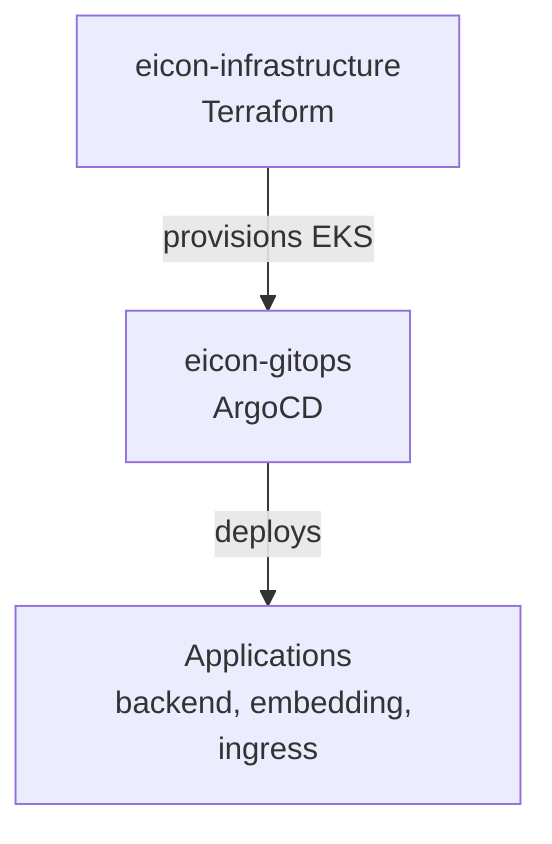
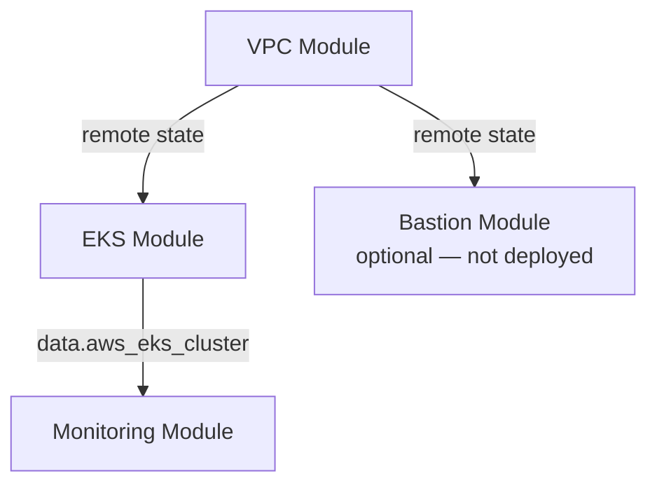

# Eicon Infrastructure Architecture

Terraform-based AWS infrastructure for the Eicon platform.

For the full platform (infrastructure + GitOps + CI/CD), see [eicon-gitops/docs/PLATFORM_ARCHITECTURE.md](https://github.com/EiconVision/eicon-gitops/blob/main/docs/PLATFORM_ARCHITECTURE.md).

For step-by-step deployment, see [eicon-gitops/docs/STAGING_RUNBOOK.md](https://github.com/EiconVision/eicon-gitops/blob/main/docs/STAGING_RUNBOOK.md).

---

## Platform Position



This repo owns everything **below** the dashed line — AWS networking, Kubernetes cluster, and observability.

---

## Repository Layout

```
eicon-infrastructure/
├── modules/
│   ├── vpc/          # VPC, subnets, NAT, IGW, security groups
│   ├── bastion/      # SSH jump host (optional — VPN used instead)
│   ├── eks/          # EKS cluster, GPU nodes, IAM, add-ons
│   └── monitoring/   # Prometheus, Grafana, Loki (Helm)
├── environments/
│   ├── staging/      # us-west-1
│   │   ├── vpc/
│   │   ├── eks/
│   │   └── monitoring/
│   └── production/   # us-east-1
│       ├── vpc/
│       ├── eks/
│       └── monitoring/
├── docs/
│   ├── ARCHITECTURE.md
│   └── vpn/scripts/
├── Makefile
└── .tflint.hcl
```

Each stack is an **independent Terraform root** with its own S3 state.

---

## Module Dependencies



### Deploy Order

```
1. VPC
2. Bastion  — skipped (VPN used)
3. EKS
4. Monitoring
```

---

## Environments

| | Staging | Production |
|---|---------|------------|
| Workload region | `us-west-1` | `us-east-1` |
| State region | `us-east-1` | `us-east-1` |
| Cluster | `eicon-staging-eks` | `eicon-production-eks` |
| VPC CIDR | `172.31.0.0/16` | `172.31.0.0/16` |
| AZs | `us-west-1a/b` | `us-east-1a/b` |
| Node type | `g4dn.xlarge` | `g4dn.xlarge` |
| K8s version | `1.35` | `1.35` |
| Node scaling | 1–3 | 1–3 |

---

## VPC Module

### Network Layout

```
172.31.0.0/16
├── 172.31.10.0/24  public  (AZ-a)  → NAT, ALB
├── 172.31.11.0/24  public  (AZ-b)  → NAT
├── 172.31.20.0/24  private (AZ-a)  → EKS nodes
└── 172.31.21.0/24  private (AZ-b)  → EKS nodes, API
```

### Resources

| Resource | Count |
|----------|-------|
| VPC | 1 |
| Internet Gateway | 1 |
| Public subnets | 2 |
| Private subnets | 2 |
| NAT Gateways | 2 |
| Elastic IPs | 2 |
| Route tables | 3 |
| Security groups | 1 (SSH) |

Worker nodes and the EKS control plane live in **private subnets**. NAT gateways provide outbound internet.

---

## EKS Module

### Cluster

| Setting | Value |
|---------|-------|
| Auth mode | `API_AND_CONFIG_MAP` |
| Endpoint | Private (required) + Public (optional, IP-restricted) |
| Secrets encryption | KMS |
| Logging | API, audit, authenticator — 30-day CloudWatch |
| OIDC | Created for IRSA |

### Node Groups

| Group | Instance | Scaling | Status |
|-------|----------|---------|--------|
| Main (GPU) | `g4dn.xlarge` | min=1, desired=1, max=3 | Active |
| DB | `t3.large` | desired=0 | Disabled |

### Add-ons

- `vpc-cni`
- `coredns`
- `kube-proxy`
- `aws-ebs-csi-driver`

### IAM Roles

| Role | Policies |
|------|----------|
| Cluster | `AmazonEKSClusterPolicy`, `AmazonEKSVPCResourceController` |
| Node | `AmazonEKSWorkerNodePolicy`, `AmazonEKS_CNI_Policy`, `AmazonEC2ContainerRegistryReadOnly`, `AmazonSSMManagedInstanceCore` |
| EBS CSI | IRSA → `AmazonEBSCSIDriverPolicy` |
| ALB Controller | Policy in `alb-controller-policy.json` — attach manually |

### Access Entries

Configured in `terraform.tfvars`:

```hcl
admin_users     = ["arn:aws:iam::491085416489:user/<name>"]
developer_users = []
```

- Admins → `AmazonEKSClusterAdminPolicy`
- Developers → `AmazonEKSViewPolicy`

Production EKS requires two var files:

```bash
terraform apply -var-file=../terraform.tfvars -var-file=terraform.tfvars
```

---

## Monitoring Module

Helm charts deployed to `monitoring` namespace on the live cluster.

| Component | Chart | Retention |
|-----------|-------|-----------|
| Prometheus | kube-prometheus-stack v55.0.0 | 7 days |
| Grafana | (in stack) | LoadBalancer |
| Loki + Promtail | loki-stack v2.10.1 | 7 days |

Storage: EBS gp3 via CSI (Retain reclaim policy).

---

## Terraform State

| Setting | Value |
|---------|-------|
| Bucket | `eicon-terraform-state-bucket` |
| Region | `us-east-1` |
| Locking | S3 native lockfiles |

```
environments/staging/vpc/terraform.tfstate
environments/staging/eks/terraform.tfstate
environments/staging/monitoring/terraform.tfstate
environments/production/vpc/terraform.tfstate
environments/production/eks/terraform.tfstate
environments/production/monitoring/terraform.tfstate
```

**Cross-stack wiring:**
- EKS reads VPC via `terraform_remote_state`
- Monitoring reads EKS via `data.aws_eks_cluster`

---

## Access Model

| Method | Status |
|--------|--------|
| OpenVPN | **Active** — primary kubectl access |
| Bastion | Not deployed (module exists) |
| Public EKS API | Optional, IP-restricted |

VPN scripts: `docs/vpn/scripts/`

### Recommended API Lockdown

```hcl
# environments/staging/eks/terraform.tfvars
cluster_endpoint_private_access      = true
cluster_endpoint_public_access       = false
cluster_endpoint_public_access_cidrs = []
```

---

## Out of Scope (Managed Elsewhere)

| Resource | Managed by |
|----------|------------|
| RDS PostgreSQL | Pre-existing / manual |
| Qdrant | Qdrant Cloud |
| ArgoCD | Manual install |
| ALB Controller | Manual Helm install |
| NVIDIA Device Plugin | Manual kubectl apply |
| App secrets | AWS Secrets Manager |
| ECR images | App CI (GitHub Actions) |
| DNS | Squarespace |
| ACM certs | Manual (referenced in GitOps) |

---

## Developer Workflow

```bash
make check    # fmt + validate + test + lint

# Staging deploy
cd environments/staging/vpc    && terraform init && terraform apply
cd environments/staging/eks    && terraform init && terraform apply
cd environments/staging/monitoring && terraform init && terraform apply -var="grafana_password=<pw>"
```

---

## Related Docs

| Document | Location |
|----------|----------|
| Platform Architecture (full stack) | [eicon-gitops/docs/PLATFORM_ARCHITECTURE.md](https://github.com/EiconVision/eicon-gitops/blob/main/docs/PLATFORM_ARCHITECTURE.md) |
| Staging Runbook | [eicon-gitops/docs/STAGING_RUNBOOK.md](https://github.com/EiconVision/eicon-gitops/blob/main/docs/STAGING_RUNBOOK.md) |
| Environments README | [environments/README.md](../environments/README.md) |
| Root README | [README.md](../README.md) |

*Last updated: June 2026*
